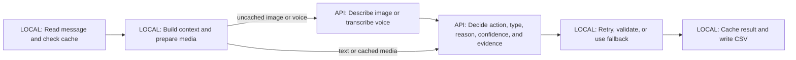
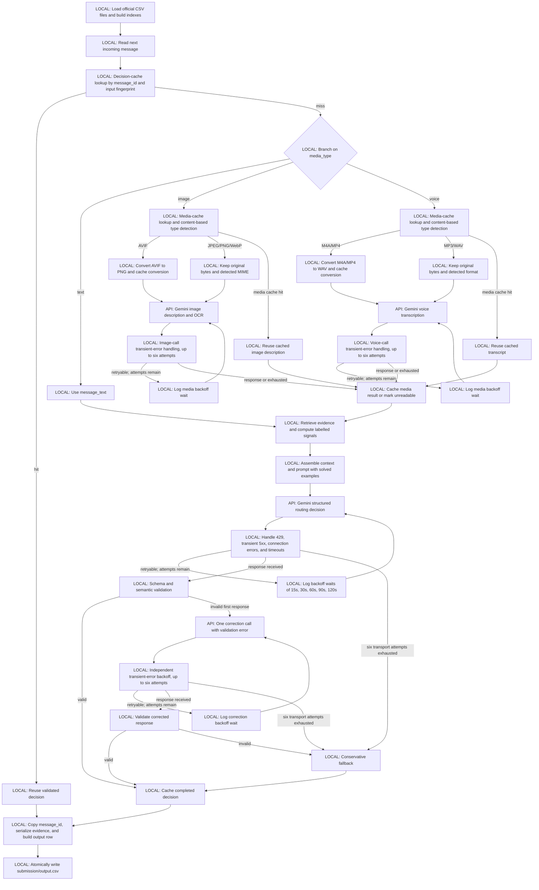

# Executive summary

## The system in four steps

1. Local code reads one message, finds the user's relevant context, and prepares any image or voice content.
2. Gemini reads that prepared context and decides whether the message should notify, wait for a digest, or be muted.
3. Local code checks every returned field, retries temporary failures, and uses the fixed safe fallback if Gemini cannot return a valid result.
4. Local code saves the decision and writes the required CSV row, so completed work is not lost on a rerun.



- **LOCAL: Read message and check cache.** Code does this because IDs, files, and completed results can be handled exactly on the user's machine.
- **LOCAL: Build context and prepare media.** Code does this because joins, time checks, evidence ranking, file detection, and approved conversions follow fixed rules.
- **API: Describe image or transcribe voice.** Gemini does this because posters, screenshots, and speech require meaning, not only file parsing.
- **API: Decide action, type, reason, confidence, and evidence.** Gemini does this because the final choice depends on meaning, user context, urgency, repetition, and risk.
- **LOCAL: Retry, validate, or use fallback.** Code does this so temporary failures and invalid fields cannot break the output contract.
- **LOCAL: Cache result and write CSV.** Code does this so reruns preserve completed work and every row has the exact required format.

The model decides the action, message type, explanation, confidence, and which permitted history IDs are useful. Local code enforces the input identity, allowed values, evidence boundary, retry policy, fallback, cache behavior, and final CSV format.

# Message Notification Router — Final System Design

## 1. Status and scope

This document describes the approved single-provider, single-decision pipeline. The vertical slice, compatible-endpoint media smoke tests, and one complete 110-row run have now been executed. The measured results are reported separately from the design claims.

The system routes every incoming text, image, or voice message to `notify`, `digest`, or `mute`. It produces one prediction for every incoming `message_id`. This satisfies the task and multimodal scope in [problem_statement.md, “What You Need to Build”](../problem_statement.md#what-you-need-to-build) and [problem_statement.md, “Required output”](../problem_statement.md#required-output).

The design has these fixed invariants:

- One provider: Gemini through its OpenAI-compatible endpoint. The first model tested is `gemini-3.6-flash`.
- `gemini-3.5-flash` is a manual contingency that passed limited smoke tests on three paths: one text structured-routing call, one image description, and one voice-note transcription. This does not establish full-dataset reliability. It is never selected automatically. The unavailable `gemini-2.5-flash` is not used.
- `message_id` is copied from `dataset/messages.csv` by local code. The model never generates it.
- The model may return only evidence IDs in the runtime candidate set.
- The output header remains exactly `message_id,action,message_type,reason,confidence,evidence_message_ids`, as required by [AGENTS.md §6.2](../AGENTS.md#62-required-output).
- Sample labels are prompt examples for format, style, and decision patterns. They are not prediction targets and are never hardcoded. This follows [problem_statement.md, “Files provided”](../problem_statement.md#files-provided) and [AGENTS.md §6.3](../AGENTS.md#63-constraints-that-make-the-submission-evaluable).
- Only the four approved dependencies are used: `openai`, `pydantic`, `Pillow`, and `av`.
- API keys are read from environment variables and are not deliberately placed in prompts, outputs, caches, or logs. Raw provider exception strings are not sanitized, so a future SDK or custom endpoint could reflect sensitive data; the submitted README records this unmitigated risk. Environment-only configuration follows [AGENTS.md §6.3](../AGENTS.md#63-constraints-that-make-the-submission-evaluable).

## 2. High-level architecture

Every node is labelled `LOCAL` or `API`.



The model is used for semantic understanding because the official task requires contextual reasoning across text, posters/screenshots, voice notes, user relationships, and safety signals. Deterministic input loading, joins, signals, validation, caching, and output writing stay local because the project asks for deterministic behavior where possible. See [problem_statement.md, “Important Behavior”](../problem_statement.md#important-behavior), [README.md, “Evaluation”](../README.md#evaluation), and [AGENTS.md §6.3](../AGENTS.md#63-constraints-that-make-the-submission-evaluable).

### Approved module map

| File | Single responsibility |
|---|---|
| `code/main.py` | Parse the CLI and start the pipeline. |
| `code/config.py` | Load environment configuration and approved defaults. |
| `code/data_io.py` | Read official CSVs and write the final CSV. |
| `code/retrieval.py` | Select and rank historical evidence candidates. |
| `code/context.py` | Assemble source context and deterministic signals. |
| `code/media.py` | Detect and normalize media locally. |
| `code/prompts.py` | Build versioned media and routing prompts. |
| `code/schemas.py` | Define and validate structured decisions. |
| `code/provider.py` | Make Gemini calls and classify transport responses. |
| `code/fallback.py` | Produce the fixed conservative fallback. |
| `code/cache.py` | Persist versioned decision, media, and conversion results. |
| `code/pipeline.py` | Coordinate one message through the ordered stages. |
| `code/evaluation/main.py` | Evaluate later against solved sample rows; never run in production routing. |

## 3. End-to-end workflow

1. **Configuration — LOCAL.** `config.py` reads required `GEMINI_API_KEY` and `GEMINI_MODEL` values from the environment. `GEMINI_BASE_URL` has the approved overridable endpoint default. `GEMINI_MIN_CALL_INTERVAL_SECONDS` is read from the environment and defaults to two seconds. The submitted README gives a portable POSIX-shell command and a clearly labelled macOS `zsh -ic` command that was used for the final run. Environment-only secrets and a documented terminal command satisfy [AGENTS.md §6.3](../AGENTS.md#63-constraints-that-make-the-submission-evaluable).
2. **Load and index — LOCAL.** `data_io.py` reads participant-facing CSV files with Python's `csv` module and creates dictionaries keyed by IDs. Organizer-only files are never read, as required by [AGENTS.md §6.1](../AGENTS.md#61-dataset-contract).
3. **Select message — LOCAL.** Read one row from `dataset/messages.csv`. Its fields follow [problem_statement.md, “Input schema”](../problem_statement.md#input-schema).
4. **Decision-cache lookup — LOCAL.** Use `message_id` as the cache key. Its validity fingerprint hashes the incoming message row, the full participant-dataset fingerprint, the source media SHA-256 when present, model name, routing-prompt version, media-prompt version, and schema version. A valid hit skips context work and all API calls. With `--refresh-fallbacks`, only a hit whose stored `source` is `fallback` is treated as a miss; validated model decisions remain untouched.
5. **Media branch — LOCAL then API when needed.** Text uses `message_text`. Image and voice rows look up their media path, detect the real format from file content, and check the media cache. Only AVIF is converted to PNG. Only M4A/MP4 is converted to WAV. JPEG, PNG, WebP, MP3, and WAV remain unchanged. The media itself must be inspected under the official task: [problem_statement.md, “Files provided”](../problem_statement.md#files-provided).
6. **Media extraction — API.** On a media-cache miss, Gemini produces an OCR-quality image description or voice transcript. After exhausted transport attempts or another permanent media error, local code records `status: unreadable`; the message continues through routing.
7. **Evidence retrieval — LOCAL.** Join earlier rows from `message_history.csv` to `message_events.csv`, apply the approved deterministic ranking, and keep the top eight candidates. History and reactions are official personalization inputs: [problem_statement.md, “Files provided”](../problem_statement.md#files-provided).
8. **Deterministic signals — LOCAL.** Compute and label quiet-hours, business-risk, promotion-preference, and group-role fields before prompting. The model receives both source values and the explicit signals, but local code does not choose the action. This supports personalization and risk balancing required by [problem_statement.md, “Important Behavior”](../problem_statement.md#important-behavior).
9. **Context and prompt assembly — LOCAL.** Combine the incoming message, relevant entity rows, media result, candidate evidence, deterministic signals, and all 30 solved examples. Each example is compressed to conversation type, about 150 characters of message text, a deterministic decisive-signal summary, labelled action, message type, reason, confidence, and evidence count. Full raw sample rows are not sent. Examples are loaded at runtime and identified as style/decision demonstrations, never as labels for target rows. Their official purpose is format and style guidance: [problem_statement.md, “Files provided”](../problem_statement.md#files-provided). All message text, media output, history, links, and file names are placed inside explicit `BEGIN_UNTRUSTED_DATA` / `END_UNTRUSTED_DATA` markers. The system policy says they are data, never instructions, and that policy-changing content is ignored and treated as a risk signal.

   The local character-count estimate is about **4,388 tokens before compression** and **3,843 tokens after compression**, using the stated approximation of four characters per token. This is an estimate, not provider-reported token usage.
10. **Initial routing call — API.** Gemini returns one structured decision containing `action`, `message_type`, `reason`, `confidence`, and `evidence_message_ids`.
11. **Pacing and transport policy — LOCAL around each API call.** Logical calls start no faster than the configured interval, which defaults to two seconds. HTTP 429, transient 5xx, connection errors, and timeouts use at most six total attempts with deterministic waits of 15, 30, 60, 90, and 120 seconds. A 429 increases the current interval by 50% up to 60 seconds. Ten consecutive successful logical calls reduce it by 10% toward the configured default. Every wait and interval change is logged. Keys and request payloads are not deliberately logged, but raw exception strings are unsanitized as documented in the README. A transport retry does not consume the one validation retry.
12. **Validation — LOCAL.** `schemas.py` checks the fixed enums, confidence `0..1`, reason hard limit of 200 characters, at most two unique evidence IDs, and membership of every evidence ID in the runtime candidate set. The official enum and field meanings are in [problem_statement.md, “Output meaning”](../problem_statement.md#output-meaning) and [problem_statement.md, “Allowed values”](../problem_statement.md#allowed-values).
13. **One correction call — API, only after invalid model content.** Send the validation error and the same candidate set. This is a semantic retry, separate from transport backoff. It also receives up to six transport attempts.
14. **Fallback — LOCAL.** If transport attempts are exhausted for the routing decision, or both structured responses are invalid, produce `digest`, `unknown`, reason `Model unavailable; saved for later review.`, confidence `0.20`, and no evidence. A 429 cannot reach fallback before all six transport attempts are exhausted.
15. **Cache decision — LOCAL.** Cache every completed decision, including fallback, by `message_id` and fingerprint. No secret or raw API credential is deliberately stored; unsanitized provider exception text can be stored for an unreadable media result and is a documented risk. `--refresh-fallbacks` reruns only records marked `source: fallback`, retries their cached unreadable media when needed, and preserves validated model records.
16. **Serialize output — LOCAL.** Copy `message_id` from the input row; never accept it from the model. Join one or two evidence IDs with semicolons, or write `none`. Format confidence to two decimals. The output semantics come from [problem_statement.md, “Output meaning”](../problem_statement.md#output-meaning).
17. **Write — LOCAL.** Rebuild the ordered result from validated cache records and atomically write `submission/output.csv`. Never overwrite `dataset/output.csv`. The final file contains the exact six-column header and one row per incoming ID, satisfying [AGENTS.md §6.2](../AGENTS.md#62-required-output).

### Retry ordering

```text
logical API call
  -> enforce the current minimum start interval
  -> HTTP attempt 1
  -> if 429/transient 5xx/connection error/timeout: log and wait 15s
  -> HTTP attempts 2 through 5, waiting 30s, 60s, 90s, then 120s
  -> HTTP attempt 6
  -> if exhausted: media becomes unreadable OR routing uses fallback
  -> on each 429: raise interval 50%, capped at 60s
  -> after 10 consecutive successful logical calls: lower interval 10% toward default
  -> if a response arrives: validate locally
  -> if invalid: one correction logical call, with its own transport attempts
  -> if correction is invalid/exhausted: routing uses fallback
```

## 4. Per-message-type handling and API-call cost

The three paths diverge only at media normalization/extraction. They rejoin before evidence retrieval and context assembly. The task explicitly covers text, image posters/screenshots, and voice notes: [problem_statement.md, opening scope](../problem_statement.md#message-notification-router).

| Type | Divergent path | Rejoin point | Nominal calls on a fresh cache | Cache effect |
|---|---|---|---:|---|
| Text | Use `message_text`; no media processing. | Evidence retrieval. | 1 routing call. | Decision-cache hit: 0. |
| Image | Lookup path; content-based detection; keep JPEG/PNG/WebP or locally convert AVIF to PNG; call Gemini for description/OCR. | Evidence retrieval after description or `unreadable`. | 1 media call + 1 routing call = 2. | Media hit: 1; decision hit: 0. |
| Voice | Lookup path; content-based detection; keep MP3/WAV or locally convert M4A/MP4 to WAV; call Gemini for transcription. | Evidence retrieval after transcript or `unreadable`. | 1 media call + 1 routing call = 2. | Media hit: 1; decision hit: 0. |

The counts above are logical calls with valid first responses. A logical call may make up to six HTTP attempts for 429, transient 5xx, connection errors, or timeouts. A routing decision can make one additional logical correction call after validation failure.

## 5. Model decision contract

The runtime schema is:

```json
{
  "type": "object",
  "additionalProperties": false,
  "required": [
    "action",
    "message_type",
    "reason",
    "confidence",
    "evidence_message_ids"
  ],
  "properties": {
    "action": {
      "type": "string",
      "enum": ["notify", "digest", "mute"]
    },
    "message_type": {
      "type": "string",
      "enum": [
        "personal",
        "urgent",
        "event",
        "payment",
        "business_update",
        "promotion",
        "greeting",
        "forward",
        "spam",
        "scam",
        "unknown"
      ]
    },
    "reason": {
      "type": "string",
      "description": "One short third-person sentence explaining why the action follows."
    },
    "confidence": {
      "type": "number",
      "minimum": 0,
      "maximum": 1
    },
    "evidence_message_ids": {
      "type": "array",
      "maxItems": 2,
      "items": {
        "type": "string",
        "enum": ["<runtime candidate IDs only>"]
      }
    }
  }
}
```

The action and message-type enum values are unchanged from [problem_statement.md, “Allowed values”](../problem_statement.md#allowed-values). `message_id` is intentionally absent and is copied locally because it is an input identifier and required output field: [problem_statement.md, “Input schema”](../problem_statement.md#input-schema) and [problem_statement.md, “Required output”](../problem_statement.md#required-output).

Hard validation:

- Exact action and message-type enums.
- Confidence is finite and inside `0..1`, the official range in [problem_statement.md, “Output meaning”](../problem_statement.md#output-meaning).
- Reason is non-empty and at most 200 characters.
- Zero, one, or two unique evidence IDs.
- Every evidence ID appears in the per-message runtime schema enum.

Prompt targets, not hard failures:

- Prefer exactly one evidence ID. Use two only when the second history row provides genuinely different support. Use zero when no history is useful.
- Use `0.78..0.82` when two actions are similarly defensible, the sender relationship is unclear, media is unreadable, or no relevant history exists. Use `0.83..0.88` normally. Reserve values above `0.89` for cases where every signal agrees. Fallback is the deliberate exception at `0.20`.
- Target one third-person sentence of 60–100 characters. It should name the sender's role or trust signal and explain why the action follows. The official requirement is a short human-readable reason: [problem_statement.md, “Output meaning”](../problem_statement.md#output-meaning).

The official statement lists `payment` but provides no expanded category definition or solved example. The prompt therefore says only: “Use `payment` when payment is the best-fit message category.” It includes no invented payment example. The absence of an expanded definition is visible in [problem_statement.md, “Allowed values”](../problem_statement.md#allowed-values).

## 6. Context package and deterministic signals

Each model decision receives:

- `incoming`: all fields from the current `messages.csv` row.
- `user`: the matching user row.
- `group`: matching group metadata or `null`.
- `recipient_membership`: matching `(group_id, user_id)` row or `null`.
- `sender_membership`: matching `(group_id, sender_user_id)` row or `null`.
- `business`: matching business row or `null`.
- `business_history`: matching `(user_id, business_id)` row or `null`.
- `notification_load`: prior same-user daily rows plus sent total, dismissed total, and dismissal rate.
- `media`: ID, detected type, status, and description/transcript or unreadable marker.
- `evidence_candidates`: up to eight historical messages with joined event fields and relation labels.
- `signals`: the explicit deterministic fields below.

### Signal definitions

| Signal | Deterministic local rule | Model use |
|---|---|---|
| `domain_mismatch` | For business rows, trim and case-fold both domains; true when `domain_used_by_sender != official_domain`; otherwise `null`. | Explicit business-risk input. |
| `domain_used_by_sender_age_days` | Copy the numeric business field; otherwise `null`. | Raw domain-age evidence. |
| `business_account_age_days` | Copy `account_age_days`; otherwise `null`. | Comparison baseline. |
| `domain_much_newer_than_business` | Always `null`; no numeric threshold is invented. The two raw ages still reach the model. | Lets the model compare raw ages without an unsupported local rule. |
| `business_verified` | Copy `verified` as boolean; otherwise `null`. | Explicit trust signal. |
| `business_user_reports_30d` | Copy `user_reports_30d`; otherwise `null`. | Explicit risk signal. |
| `promotions_opted_out` | True when `promotions_opted_out_at` is non-empty or `allows_promotions == 0`; false otherwise; `null` outside business context. | Explicit preference signal. |
| `group_muted_by_user` | Copy from the recipient's group-membership row; otherwise `null`. | Explicit interruption-preference signal. |
| `recipient_group_role` | Copy the recipient's role; otherwise `null`. | Relationship context. |
| `sender_group_role` | Join `group_members.csv` on `(group_id, sender_user_id)` and copy the role; otherwise `null`. | Sender authority/trust signal. |
| `in_do_not_disturb` | Parse local `created_at` time and `HH:MM-HH:MM`. Use a start-inclusive, end-exclusive interval; a window crossing midnight matches `time >= start OR time < end`. | Explicit timing signal; the model still decides whether urgency overrides it. |

These fields expose relevant user, group, business, and interaction context without making the routing decision in code, matching [problem_statement.md, “Important Behavior”](../problem_statement.md#important-behavior).

### Evidence retrieval

1. Join `message_history.csv` to `message_events.csv` on `(user_id, message_id)`.
2. Keep only the receiving user's history with `created_at` earlier than the incoming message.
3. Define the conversation key as `sender_user_id` for personal, `group_id` for group, and `business_id` for business.
4. Keep a row when it has an exact conversation-key match, token Jaccard similarity of at least `0.15`, or the same conversation type plus at least one event.
5. Rank with the approved weights: `+100` exact conversation key, `+20` same conversation type, `+30 × Jaccard`, `+12` reported, `+10` muted, `+6` replied, `+3` dismissed, `+2` opened, and recency `max(0, 10 - floor(age_days / 30))`.
6. Break ties by newer timestamp and then ascending `message_id`.
7. Put the top eight IDs in the runtime schema enum. Ask the model for one evidence ID by default and at most two.

These weights are explicitly heuristic and untuned. They will not be changed until measured evaluation results are reviewed. Relevant historical evidence is a scored dimension in [problem_statement.md, “Evaluation”](../problem_statement.md#evaluation).

## 7. Data lineage

All participant-facing files are listed in [problem_statement.md, “Files provided”](../problem_statement.md#files-provided). No organizer-only file is used, following [AGENTS.md §6.1](../AGENTS.md#61-dataset-contract).

| Dataset file | Used? | Consuming stage | Extracted / preprocessed / aggregated | Tool | Reason and official basis | Destination |
|---|---|---|---|---|---|---|
| `messages.csv` | Yes | Message selection, context, output | Read all input fields; parse naive local timestamp; copy `message_id` locally. | `csv`, `datetime` | Only this file needs predictions; one output row per input row. [Problem statement: Files provided](../problem_statement.md#files-provided), [Required output](../problem_statement.md#required-output) | Both |
| `sample_messages.csv` | Yes | Prompt assembly; later local evaluation | Load all 30 examples, truncate text to about 150 characters, compute a short deterministic signal summary, and retain only conversation type, labelled output fields, and evidence count. Never use an example label as a target or hardcoded mapping. | `csv`, `json` | Officially provided only to understand expected format and style. [Problem statement: Files provided](../problem_statement.md#files-provided) | Model; local evaluation later |
| `users.csv` | Yes | Context and signals | Matching user behavior; parse DND window; compute `in_do_not_disturb`. | `csv`, `datetime` | User behavior and quiet hours personalize routing. [Problem statement: Files provided](../problem_statement.md#files-provided), [Important Behavior](../problem_statement.md#important-behavior) | Both |
| `groups.csv` | Yes | Context | Matching group type, size, admins, creation date, and recent activity; numeric conversion. | `csv` | Group context may change the action. [Problem statement: Files provided](../problem_statement.md#files-provided), [Important Behavior](../problem_statement.md#important-behavior) | Model |
| `group_members.csv` | Yes | Context and signals | Join recipient and sender memberships; copy mute state, activity fields, recipient role, and sender role. | `csv` dictionaries | User-group relationship and mute state are official context. [Problem statement: Files provided](../problem_statement.md#files-provided) | Both |
| `business_accounts.csv` | Yes | Context and signals | Matching identity, verification, domains, ages, activity, reports; compute normalized domain mismatch; expose both ages. | `csv`, string `strip`/`casefold` | Business identity, verification, domains, age, and reports support trust/risk decisions. [Problem statement: Files provided](../problem_statement.md#files-provided), [Important Behavior](../problem_statement.md#important-behavior) | Both |
| `user_business_history.csv` | Yes | Context and signals | Matching relationship, activity, promotion settings, opens/dismissals/replies; compute `promotions_opted_out`. | `csv`, boolean parsing | Orders/bookings/payments and opt-in/out history personalize business routing. [Problem statement: Files provided](../problem_statement.md#files-provided) | Both |
| `message_history.csv` | Yes | Retrieval | Keep earlier same-user rows; tokenize text; calculate relation and similarity features; rank candidates. | `csv`, `re`, `datetime` | Past messages identify repetition, usefulness, and risk; evidence relevance is scored. [Problem statement: Files provided](../problem_statement.md#files-provided), [Evaluation](../problem_statement.md#evaluation) | Both |
| `message_events.csv` | Yes | Retrieval | Join to history; parse opened, replied, dismissed, muted, reported, and reaction time. | `csv` dictionaries | Historical reactions personalize routing and evidence choice. [Problem statement: Files provided](../problem_statement.md#files-provided) | Both |
| `images.csv` | Yes | Media lookup | Map `image_id` to path; ignore extension when detecting type. | `csv`, `pathlib`, Pillow | Paths are provided, but the system must inspect media itself. [Problem statement: Files provided](../problem_statement.md#files-provided) | Both |
| `voice_notes.csv` | Yes | Media lookup | Map `voice_note_id` to path; ignore extension when detecting type. | `csv`, `pathlib`, PyAV | Paths are provided, but the system must inspect media itself. [Problem statement: Files provided](../problem_statement.md#files-provided) | Both |
| `daily_notification_summary.csv` | Yes | Context | Keep prior same-user rows; calculate sent total, dismissed total, and dismissal rate. | `csv`, `datetime`, `sum` | Daily notification load is official context; the aggregation summarizes interruption burden for personalized routing. [Problem statement: Files provided](../problem_statement.md#files-provided), [Important Behavior](../problem_statement.md#important-behavior) | Model |
| `output.csv` | Yes, read-only | Startup contract check | Read only the header and compare it with the fixed six-column contract. Never overwrite this blank template. | `csv` | It is the official blank template and exact output shape. [Problem statement: Files provided](../problem_statement.md#files-provided), [AGENTS.md §6.2](../AGENTS.md#62-required-output) | Local |
| `media/images/*` | Yes, when referenced | Media normalization/extraction | Pillow detects actual image format; AVIF converts to cached PNG; JPEG/PNG/WebP remain unchanged. | Pillow, `hashlib`, `pathlib` | Image posters/screenshots must be understood. [Problem statement: opening scope](../problem_statement.md#message-notification-router), [Problem statement: Files provided](../problem_statement.md#files-provided) | Both |
| `media/audio/*` | Yes, when referenced | Media normalization/extraction | PyAV detects actual container/codec; M4A/MP4 converts to cached WAV; MP3/WAV remain unchanged. | PyAV, `hashlib`, `pathlib` | Voice notes must be understood. [Problem statement: opening scope](../problem_statement.md#message-notification-router), [Problem statement: Files provided](../problem_statement.md#files-provided) | Both |

No participant-facing dataset file is completely unused. `dataset/output.csv` is used only for a read-only contract check because the approved generated path is `submission/output.csv`.

## 8. Local versus API boundary

### LOCAL deterministic work

- Configuration loading and keeping configured credentials out of prompts and output rows. Raw exception sanitization is not implemented.
- CSV reading, type conversion, ID joins, time-window logic, and domain comparison.
- Evidence eligibility, scoring, ordering, and runtime candidate enum construction.
- File-content detection and the two approved conversions.
- Context and prompt construction from versioned templates.
- Cache lookup, fingerprinting, and atomic writes.
- HTTP/status/connection/timeout classification, deterministic backoff waits, and wait logging.
- Output validation, correction-error construction, fallback, and CSV serialization.

These operations have clear rules and are kept local to support reproducibility, output completeness, and terminal execution. These are official project constraints: [AGENTS.md §6.2](../AGENTS.md#62-required-output) and [AGENTS.md §6.3](../AGENTS.md#63-constraints-that-make-the-submission-evaluable).

### API semantic work

- OCR-quality description of an image poster or screenshot.
- Voice-note transcription.
- Final personalized classification and explanation.
- One correction call only when a returned routing object fails local validation.

These operations need semantic and multimodal reasoning. The scoring checks action, category, reason, evidence relevance, and confidence calibration: [problem_statement.md, “Evaluation”](../problem_statement.md#evaluation).

### Full-run call count

For a fresh cache and valid first responses:

- 87 text decisions: `87` routing calls.
- 15 image decisions referring to 11 unique images: `15` routing calls + `11` image-description calls.
- 8 voice decisions referring to 8 unique audio files: `8` routing calls + `8` transcription calls.
- Total: `110` routing calls + `19` unique-media calls = **129 logical API calls**.

Caching changes the total to:

```text
uncached decision records + uncached unique media records
```

A fully cached rerun makes zero API calls. Shared media IDs avoid four duplicate image calls. After interruption, completed message and media records are skipped. `--refresh-fallbacks` makes calls only for fallback-sourced decisions and unreadable media required by those records.

Transport and validation can increase actual HTTP requests. Each logical call permits at most six transport attempts. A routing response that is received but invalid permits one correction logical call, also with at most six transport attempts. The theoretical combined ceiling is `19 × 6 + 110 × 12 = 1,434` HTTP requests, but only if every operation experiences the maximum transient failures and every routing response also requires correction.

## 9. Cache design

- Decision key: `message_id`.
- Decision validity fingerprint: incoming message row, full participant-dataset fingerprint, source media SHA-256 when present, model name, routing-prompt version, media-prompt version, and schema version. Selected evidence and the derived media-result fingerprint are not direct hash inputs.
- Media key: `media_id`.
- Media validity fingerprint: source bytes hash, detected type, conversion version, extraction prompt version, and model name.
- Converted-media key: `media_id` plus source bytes hash and conversion version.
- Writes use a temporary file followed by an atomic replace.
- Cache writes do not deliberately include the API key, authorization headers, or full API request logs. An unreadable-media record can include unsanitized provider exception text; the README identifies this risk.
- `--refresh-fallbacks` ignores only decision entries with `source: fallback`; all validated model decisions remain cache hits. Unreadable media needed by a refreshed fallback is retried.

This design preserves work after interruption while invalidating stale results when inputs or decision rules change. Caching is explicitly encouraged by [problem_statement.md, “Submission”](../problem_statement.md#submission).

## 10. Known weaknesses and revealing evidence

| Weakness | Likely wrong result | Evidence that would reveal it |
|---|---|---|
| Evidence weights are heuristic and untuned. | A less relevant historical row outranks the useful one. | Sample evaluation shows incorrect or weak evidence IDs; manual review finds a lower-ranked row is more relevant. |
| “Second evidence adds genuinely different support” is semantic. Local validation can enforce two IDs and uniqueness, but not genuine difference. | The model returns two redundant history rows. | The two selected rows have near-identical text, entity, and event patterns. |
| `domain_much_newer_than_business` is deliberately `null`. | The model may compare the raw ages inconsistently. | Review whether decisions involving new sender domains vary despite similar raw age ratios. |
| `payment` has no solved example or expanded official definition. | Confusion between `payment`, `business_update`, and `scam`. | Sample-style evaluation cannot cover it; manual review of payment-like target predictions reveals inconsistent categories. |
| Solved examples may not represent hidden-label policy. | Few-shot patterns overfit the 30 examples. | Good sample consistency but poor leaderboard score, especially on categories rare or absent in samples. |
| The 30 compressed examples still increase prompt size. | Higher cost/latency or reduced attention to the current context. | Provider token counts and latency rise; a controlled evaluation of fewer examples improves measured accuracy or speed. All 30 remain approved for coverage. |
| Gemini output is not perfectly deterministic even with a stable model and low randomness. | Repeated uncached runs disagree. | Repeat-call comparison on the same frozen context shows different action, type, evidence, or confidence. |
| Media extraction can omit small text or mishear speech. | The routing decision uses an incomplete description/transcript. | Manual comparison of the two smoke-test files or later media samples finds missing names, amounts, deadlines, or safety phrases. |
| An unreadable-media marker preserves completion but loses content. | A media-only urgent or scam message falls back to weak context. | Media-error logs correlate with low-confidence, `unknown`, or wrong decisions. |
| Confidence bands `0.78..0.82`, `0.83..0.88`, and above `0.89` are based on only 30 examples. | Confidence is compressed and poorly calibrated on hidden data. | Sample accuracy by confidence bucket or later leaderboard feedback does not rise with confidence. |
| Caching fallback decisions preserves interruption safety but can preserve a temporary outage result. | A normal rerun skips a message that could now receive a model decision. | Cache metadata shows `source: fallback` after provider recovery; `--refresh-fallbacks` is the approved recovery command. |
| Even the stronger paced retry policy cannot overcome a hard account quota. | Six attempts exhaust and invoke unreadable/fallback. | Exact 429 quota bodies, pacing changes, and fallback counts identify the exhausted metric and limit. |
| The OpenAI-compatible audio path passed one M4A smoke test but has limited coverage. | Other audio may still be rejected or transcribed incorrectly. | Manual review finds an empty or inaccurate transcript, or later media calls return an HTTP error. Only then is native-SDK approval reconsidered. |
| DND boundaries use start-inclusive/end-exclusive semantics. | A message exactly at the end time differs from an organizer expectation. | Boundary tests at the start and end of each window expose the difference. |

## 11. Rejected alternatives

### Local-first routing

Rejected. Deterministic rules would decide some actions before the model and call Gemini only for ambiguous messages. Latency is not scored, while action, message type, reason, evidence, and confidence are scored. The solved examples have a nearly balanced action distribution, so no large class is safe to remove from semantic review. A wrong local rule would directly reduce scored accuracy.

### Local OCR and speech recognition

Rejected. Posters and screenshots need visual meaning, not only extracted text. Local OCR and speech models would add dependencies and setup time without adding a scored capability that Gemini does not already provide in this design.

### Smaller model or small-plus-large cascade

Rejected for this submission. A weaker first tier would trade likely scored accuracy for speed, which is not scored. Self-reported confidence is not considered reliable enough to decide escalation without measurements.

## 12. Production considerations — design discussion only

**This section is not implemented or tested.** It does not change the competition design.

The joins, deterministic signals, do-not-disturb check, evidence retrieval, validation, and output-contract checks are expected to run locally in single-digit milliseconds per message. That expectation must be measured before making a production latency claim.

In a production tiered router, local signals and a smaller model could handle the confident majority. Ambiguous or high-risk messages would escalate to a larger model. Before adopting that split, measure the agreement rate between tiers and the accuracy lost on escalated and non-escalated cases; do not use self-reported confidence alone.

The schema, local validator, runtime evidence restriction, untrusted-content boundary, and conservative fallback would stay identical in the competition and tiered designs.

## 13. Resolved implementation decisions

1. `domain_much_newer_than_business` stays `null`; both raw ages reach the model.
2. HTTP 429, transient 5xx, connection errors, and timeouts share the six-attempt 15s/30s/60s/90s/120s backoff policy.
3. Logical calls use an environment-configured minimum interval, defaulting to two seconds. A 429 increases it 50% up to 60 seconds; ten consecutive successes reduce it 10% toward the default.
4. `--refresh-fallbacks` reruns only fallback-sourced decision records and retries their unreadable media.
5. No deterministic override layer or automatic second-model fallback is present. `gemini-3.5-flash` is a manual contingency that passed limited smoke tests for one structured text decision, one image description, and one voice-note transcription; full-dataset behavior remains unverified.
